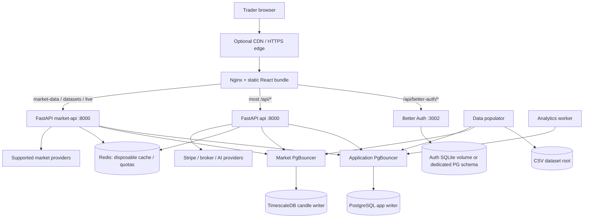
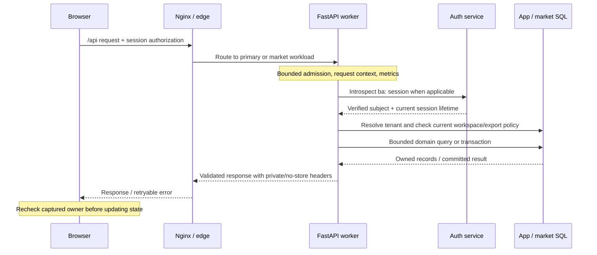
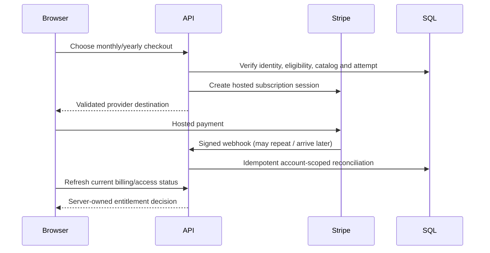
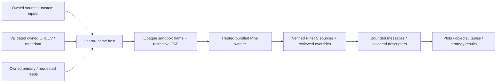

# EdgeLab architecture

This guide describes the implemented system, its ownership boundaries, and why they matter when changing or deploying it. It does not promise every TradingView feature, external provider activation, Kubernetes support, or independently certified high availability. Start with the [documentation index](README.md); use [configuration](configuration.md) and [maintenance](maintenance.md) for operating procedures.

## 1. System shape

EdgeLab is a modular application with a React browser and one primary Python domain package. Production runs that package in two API services and background processes. The APIs are workload-isolated instances of the same FastAPI application, not separate independently versioned business microservices. Better Auth is a separate Node service because it owns the OAuth/session protocol. The older Node API is compatibility-only.

The diagram shows the base production stack. The efficient overlay directs market traffic to the application PostgreSQL writer/pooler and omits the separate Timescale services. Local Compose uses one API and separate SQLite files. These are deliberate alternatives, not automatic migrations.

| Mode | Application data | Candle data | Auth sessions | Important boundary |
| --- | --- | --- | --- | --- |
| Base production Compose | PostgreSQL through PgBouncer | Separate TimescaleDB through its pooler | Auth SQLite unless explicitly configured for PG | Separate market and transactional workload budgets |
| Base + efficient overlay | Same PostgreSQL writer/pooler | Indexed SQL candles on that writer | Same auth choices | New-install optimization; existing candle data must be migrated deliberately |
| Local Compose | `/var/lib/edgelab/edgelab.db` | `/var/lib/edgelab/market_data.db` | Isolated auth SQLite volume | Beta/development secrets and bypass; unsuitable as public production defaults |
| Native development | Explicit `DATABASE_URL`, otherwise loopback PostgreSQL | Explicit market URL/host, otherwise app engine | Legacy auth unless Better Auth explicitly enabled | Environment must be supplied; `.env` is not automatically read by the dev launcher |

## 2. Repository and dependency boundaries

| Layer | Entry / source | Responsibility |
| --- | --- | --- |
| Browser entry | [main.tsx](../frontend/src/main.tsx), [AppRoutes.tsx](../frontend/src/routes/AppRoutes.tsx) | Preferences, lazy route loading, presentation rollout and session refresh |
| Workspace | [App.tsx](../frontend/src/App.tsx), [components](../frontend/src/components/) | Live/replay/journal/report/settings surfaces and shared controls |
| Browser data | [api.ts](../frontend/src/lib/api.ts), [serverStorage.ts](../frontend/src/lib/serverStorage.ts), [backtestStore.ts](../frontend/src/store/backtestStore.ts) | Typed HTTP boundary, owned persistence and replay state |
| Application composition | [main.py](../backend/app/main.py) | Lifespan, middleware, errors, health and router mounting |
| HTTP contract | [routes.py](../backend/app/api/routes.py), [billing.py](../backend/app/api/billing.py), [schemas.py](../backend/app/schemas.py) | Input/output validation, authentication dependencies and domain orchestration |
| Domain services | [services](../backend/app/services/) | Replay, journal, market data, billing, cache, secrets, sharing and Quant/AI behavior |
| Durable model | [models.py](../backend/app/models.py), [market_data_db.py](../backend/app/market_data_db.py) | Tenant-owned relational records and optional candle engine |
| Auth protocol | [auth.mjs](../backend/auth/auth.mjs), [server.mjs](../backend/auth/server.mjs) | Native Better Auth routes and fixed-key private introspection/revocation |
| Background processes | [data_populator.py](../backend/app/data_populator.py), [analytics_worker.py](../backend/app/analytics_worker.py) | Scheduled ingestion and materialized summary refresh |
| Deployment | [Compose](../docker-compose.local.yml), [Nginx](../docker/nginx.conf), [Dockerfile](../backend/Dockerfile) | Proxy routing, environment configuration, and container lifecycle |

Routes and models are currently large shared modules. Add new behavior to the existing owning service and contract rather than copying logic into UI handlers or the legacy API. Extract a module when a real domain boundary and regression coverage justify it; introducing additional network services is not automatically an improvement.

## 3. Browser composition and state

Public pages, account management, auth callbacks and the workspace are lazy routes. Heavy chart/Pine/Three.js code must not enter the initial public page unnecessarily. UI rollout policy selects modern or compatibility presentation; cached policy and server kill switches preserve recovery. A presentation switch cannot change authorization.

React handles rendering; Zustand owns replay/result state. Components use typed API helpers and account-scoped server storage instead of writing arbitrary persistence keys. `serverStorage.ts` maintains a local cache and serialized write queues, but durable application preferences belong to account-owned SQL storage. Save success requires acknowledgment; local drafts/cache are not proof that a server accepted a change.

Account identity is captured before asynchronous operations and checked again before publishing results. The account-data barrier coordinates import/reset with participants; operation receipts prevent an ambiguous response from silently replaying a replacement. Replay mutations serialize per account/session and reject stale generations. Switching accounts, replacing data, cancelling a request or changing the replay selection must retire stale work even when the user later returns to the original account.

The shared design uses semantic tokens, dark/light/system workspace preference, themed controls and accessible overlays. Chart height/time range should survive pane changes. Reduced motion and the public page motion override are separate from trading state. See [frontend guide](../frontend/README.md), [design](../frontend/DESIGN.md) and [UI quality contract](ui-quality-contract.md).

## 4. HTTP request lifecycle

Public health/auth/pricing routes have their own policies; account/billing management does not require workspace access. Private business routes require the appropriate identity/workspace/subscription dependency. Numeric record IDs and browser route guards are not authorization.

Sync SQL work runs through FastAPI's thread pool. Each worker has bounded SQL pools and a bounded ordinary request budget derived from pool capacity and actual thread headroom. A small FIFO admission queue waits on the event loop, not on SQL threads. Validation and probes retain headroom. Saturation produces retryable 503 responses rather than letting unbounded checkout waiters consume all worker threads. Google and billing provider work have separate rate/concurrency admission.

Middleware timings cover complete ASGI response/stream and dependency cleanup. A stream can fail after sending status 200; interruption metrics distinguish that from a fully completed response. Private success and error responses stay no-store. The exact prefix and exclusions are defined by [Nginx](../docker/nginx.conf) and [main.py](../backend/app/main.py), not a duplicated proxy in the browser.

## 5. Identity, tenant isolation and entitlements

Better Auth owns the Google authorization-code flow and signed revocable sessions. The browser starts an owned, time-limited auth attempt, navigates only to Google's validated HTTPS host, consumes the callback once, and bridges the session through `/api/auth/better-auth/exchange`. The API uses a fixed internal auth URL and a distinct service key; it does not accept arbitrary browser identity claims or introspection destinations.

The verified Google subject maps to the stable numeric application account. Better Auth's provider user/session IDs are not substitutes for EdgeLab's tenant ID. Session storage is separate from trade/billing data. Existing supported legacy JWT sessions retain server-side session records and expiry checks; native development keeps legacy auth unless explicitly enabled otherwise.

Auth SQLite is appropriate for a single writer. Independent auth replicas need the configured direct PostgreSQL writer and dedicated schema, common signing/service keys and identical public origin. Native schema migration holds a transaction advisory lock on a pinned connection. Logout verifies actual deletion; a provider success response alone cannot certify cross-replica revocation. Switching auth stores needs explicit migration or re-login.

Tenant models and queries carry owner IDs. Storage, broker metadata, histories, scripts, imported candles, shares and analytics must remain owner-scoped. The current candle design can duplicate a dataset per account; this is a real storage/ingestion scaling cost, not an assumed shared global feed cache.

Production workspace policy requires verified Google identity and fresh live subscription access. Beta admission has separate approval/seat rules. Export policy always requires verified active live paid access, including in beta. Local bypass, manual beta identity, test billing, a success URL and the `variant=beta` marketing parameter do not elevate that policy.

## 6. Stripe and other external work

Prices, secret keys and webhook verification are server-owned. Customer/subscription records separate test and live modes. Checkout/portal calls and stale access refreshes use bounded shared quotas; configured Redis failure fails closed for that provider admission. Webhook/customer reconciliation and current provider verification own access, not a browser redirect. See [backend billing](../backend/README.md).

Persisted integration secrets are authenticated/encrypted with the server keyring and bound metadata. Some live broker connections accept transient user-entered JWT/feed credentials in the browser and authenticated first WebSocket message. That supported transport is distinct from server-only persisted secrets. Use HTTPS/WSS and keep credentials out of URLs, logs, screenshots, source offers and shared snapshots.

Broker synchronization imports supported provider activity into normalized owner-scoped records. Manual replay orders are simulation orders, not instructions to a live broker. Quant/AI services manage owned conversations, jobs, generated artifacts, script versions and usage/audit records; external execution needs actual configured/entitled providers. Model availability or generated source is not proof of correctness or TradingView compatibility.

## 7. Durable data and caches

| Store | Authoritative content | Recovery/upgrade implication |
| --- | --- | --- |
| Application SQL | Accounts, legacy sessions, replay orders/executions/trades, journal imports/canonical trades, app storage, billing, secrets, sharing, market metadata, Quant/AI records | Back up and restore schema + data; use reviewed application migrations |
| Optional candle SQL engine | Imported owner/dataset/timeframe candles | Preserve source identities, uniqueness, chronological indexes and deliberate storage migration |
| Auth store | Better Auth identities/accounts/sessions/verification records | Preserve writer/schema and signing keys; explicit store switch or re-login |
| Dataset filesystem | Portable CSV history and populator resume manifest | Read-only API mount; writer-owned populator mount; backup alongside SQL when needed |
| Redis | Versioned read-model caches and provider admission counters | Disposable bounded state; never a durable account/billing authority |
| Browser memory/storage | Owned UI cache, preferences/drafts, current auth handoff | Can be cleared/rejected; never establishes entitlement or server commit |
| Monitoring volumes | Metrics, logs, traces and dashboard state | Separate retention/disk/privacy policy; not application backups |

Application schema changes use Alembic. `create_all` at API startup and compatibility SQLite helpers do not replace a reviewed migration for existing production schemas. Startup runs migrations and candle initialization before API workers in Compose. The separate market engine is shared with the primary engine when URLs match; do not create accidental duplicate connection pools.

Read-model caches reduce repeated dashboard/summary SQL. Keys/versions preserve tenant and mutation generation. A Redis read failure can fall back to SQL; a failed shared invalidation cannot acknowledge a globally coherent mutation as success. SQL remains durable authority. Bounded `noeviction` Redis can refuse writes when full, so failure counters and headroom matter even though cache contents are disposable.

## 8. Market data and background processes

Dataset services discover CSVs only within the configured dataset root, track owned asset/timeframe records and provide bounded chart windows. Imported SQL candles use indexed chronological/offset queries; configured fallback paths can read CSVs. Changing filenames, ownership keys or timezone interpretation can affect replay reproducibility.

The scheduled data populator fetches M1 source history, updates its resume manifest, derives larger intervals, and imports configured SQL candles. PostgreSQL advisory locks coordinate overlapping work across processes; local Python locks cannot replace them when adding replicas. The analytics worker refreshes session/dashboard summaries outside foreground requests, reducing repeated scans while preserving full history.

Supported live providers supply candles or qualified tick/depth data through their actual adapters. Frontend feed ownership retires connections on symbol/account/context changes. A current primary update is distinct from a secondary request update. OHLCV bars cannot prove attributed historical bid/ask activity; order-flow views must retain provenance/entitlement/quality checks. Demo history remains synthetic.

Canonical timestamps are UTC; chart transport and native Pine time coordinates use their adapters' declared units. Preserve session/DST/calendar behavior at the specific adapter/calculation boundary. A supplied display timezone is not permission to reinterpret persisted timestamps or fabricate missing candles.

## 9. Replay and indicator execution

There are two distinct testing paths:

- Server manual replay: `services/backtester.py` owns the session cursor, simulated orders, fills, partial exits, position/risk state and persisted results. Browser playback can stage local progress within its owned window, but mutations synchronize to the owning server session.
- Native Pine strategy tests: browser workers execute script calculations and their broker ledger against supplied candles/provider updates. This is not the server manual-replay order engine or a live broker execution service.

Original EdgeLab DSL and native Pine are separate runtimes. PineTS package/source-map/override hashes are verified before building; the installed upstream package is not silently patched. Native user code executes in an isolated worker launched from an opaque sandbox frame. Host/frame identity, nonce and bounded result schemas protect the bridge; CSP denies network/import/storage access. Deadlines, cancellation and termination protect availability. This does not impose a universal total-heap/operation budget or establish a complete security proof for arbitrary future engine changes.

Historical runs see only supplied available candles; replay must not leak future bars. Supported persistent Binance contexts preserve committed history, roll back ordinary provisional state and retain supported `varip` state between received updates. Confirmed and forming candles are distinct. Requested child contexts consume their own real owned feeds; their updates do not invent primary ticks or advance the primary broker. Strategy fills on received kline updates cannot account for unreceived exchange trades.

Custom inputs and script source/version identity remain preserved. Native plots/drawings/tables are validated and projected through chart primitives; source version, offsets, placement and missing values matter. Geometry, warmup seeds, calendar coverage and some request/strategy semantics have disclosed local limits. See [feature reference](frontend-feature-reference.md) and [engine record](../frontend/vendor/pinets/README.md); do not describe this as exact TradingView parity.

## 10. Observability and resource control

Prometheus metrics aggregate all Gunicorn workers in a fresh per-master private mmap directory. Dead-worker live gauges retire while counters remain until master exit. Route/method labels are finite; raw URLs, query values and account IDs are excluded. Request timing includes response streaming and cleanup.

Success logs are sampled; failures and slow requests remain observable at the configured level. Exception logging retains type and stack locations instead of bound SQL values. OTLP export sanitizes attributes/events/resources, uses a bounded background queue and one HTTP attempt per batch, and bounds shutdown wait. Its custom SDK lifecycle code is pinned and upgrade-sensitive.

The optional private profile provides Grafana, Prometheus, Alloy, Loki, Tempo and dedicated SQL exporters. Alloy discovers only this Compose project's app services; an isolated Docker API guard denies write/archive/exec APIs and synthesizes non-secret metadata rather than forwarding inspect environments. It remains a trusted log reader on a dedicated deployment host. Retention and container log rotation limit cost; filesystem log/trace retention is not an exact disk quota. Alerts are evaluated locally; external paging is not configured.

## 11. Deployment, scale and latency

Nginx serves precompressed immutable assets and same-origin APIs. An external CDN can cache fingerprinted assets while bypassing all private/auth/stream/export paths. Better Auth callbacks/cookies, browser routes and API base URL must agree on one public HTTPS origin. Exact proxy rules, security headers and Google exchange admission are configuration contracts.

Horizontal app replicas need shared application SQL, optional shared auth SQL, common secrets/origin, bounded combined pooler/server connections and a load balancer that removes unhealthy/draining nodes. A second API container sharing the same host, writer or SQLite session file is not an independent failure domain. HA requires a tested writer/standby/failover plan, Redis/admission recovery, backups, and measured survivor capacity.

Adding workers or queue depth does not create CPU, memory or database capacity. Global round-trip latency affects authentication introspection, provider calls, chart bootstrap and interaction. Keep latency-sensitive services close to their writer, deliver static assets near users, measure regional full-wall SLOs and avoid chatty large bootstrap responses.

## 12. Upgrade and extension rules

Change the owning service/contract, preserve tenant identity and current compatibility, update coupled environment/proxy/build inputs, then validate the affected boundary. Add schemas with expand/backfill/contract sequencing when old and new code overlap. Keep a restorable data backup and schema-aware rollback plan; an old image cannot safely undo every migration.

Upgrade families together where required: Better Auth client/server; Pine version/manifests/overrides/namespace records; OTel core/exporter/instrumentation; Node runtime and native SQLite support; database driver/server/pooler. Preserve AGPL source/provenance and rebuild API/browser source offers from the same checkout. Record significant decisions, not routine wording changes. The [maintenance guide](maintenance.md) maps changes to real validation and release gates.

The current limits to plan around are large shared modules, account-specific candle duplication, some full CSV/DataFrame work, optional real-store checks that can skip, a legacy Jenkins deploy path with unsafe host-wide operations, unconfigured external paging, and unverified production regional/failover behavior. These are engineering constraints documented for maintainers, not public product claims or a roadmap.
