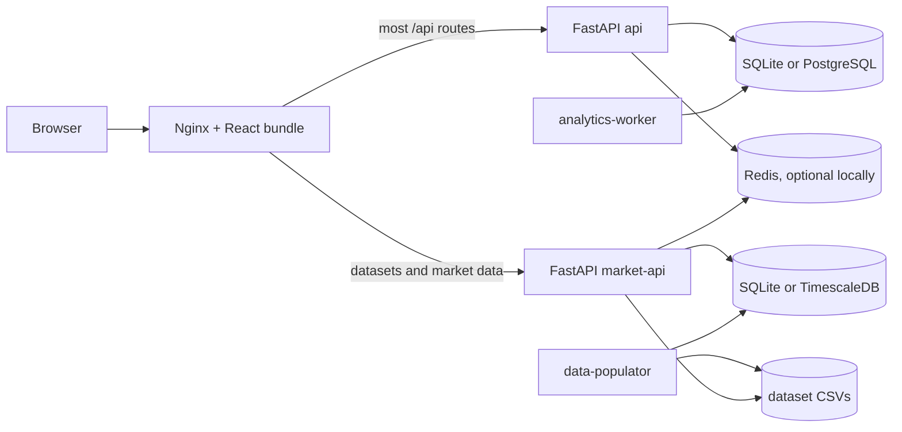

# Architecture

EdgeLab has one product application with two supported deployment sizes.

## Deployment sizes

`docker-compose.local.yml` is the normal single-user choice. It runs Nginx and one FastAPI container, stores application and market data in SQLite, mounts `datasets/` read-only, and enables loopback-only developer sign-in.

`docker-compose.yml` is the production-shaped stack. It separates transactional and market-data API traffic, uses PostgreSQL and TimescaleDB through PgBouncer, enables Redis, and runs the data-population and analytics workers. The `benchmark` profile adds Grafana, Prometheus, Loki, Tempo, exporters, MinIO, and k6. The `legacy-node-api` profile adds the old Node service.

## Request paths

- Nginx serves the compiled React application and sends `/api/market-data/*` and `/api/datasets/*` to `market-api`.
- Other `/api/*` requests go to the main `api` service.
- Both API services use the same FastAPI image and route set; the split is for workload isolation.
- Browser authentication uses an EdgeLab session token issued after Google OAuth, manual beta access, or the loopback-only development bypass.

## Data ownership

- The application database owns users, sessions, orders, executions, trades, journals, settings, broker metadata, and shared-workspace records.
- The market-data database owns imported candles.
- CSV files remain the portable source for dataset discovery and fallback reads.
- Redis contains disposable caches and rate-limit counters; it is never the source of truth.
- Broker secrets are encrypted before storage. Production requires the configured vault keyring.

## Background work

`data-populator` downloads M1 data, updates the dataset manifest, derives larger timeframes, and optionally imports candles into the market-data database. `analytics-worker` refreshes journal and session summaries. Both use the same Python package as the API.

The compatibility Node API is isolated behind an explicit Compose profile and should not receive new product behavior.
