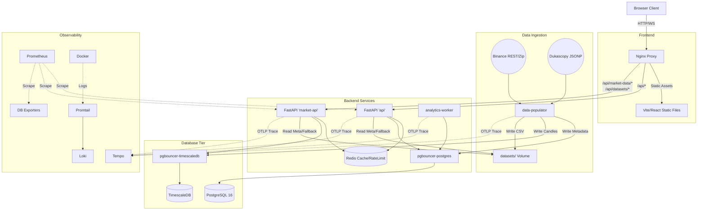

# System Architecture

## Overview
EdgeLab is designed as a containerized, decoupled architecture supporting high-throughput market data ingestion and low-latency transactional trade journaling.

## Component Responsibilities

1. **Frontend (Vite/React)**: Served as a static SPA by Nginx. Maintains local state for the active backtest replay using Zustand.
2. **Nginx Proxy**: Routes frontend asset requests and handles API path routing to specific FastAPI containers to split transactional and market-data workloads.
3. **api (FastAPI)**: Handles the transactional load: authentication, sessions, trade creation, position updates, journaling, and performance metric calculations.
4. **market-api (FastAPI)**: Handles heavy read-paths for candlestick data and dataset catalog metadata.
5. **data-populator (Python Worker)**: Runs on a schedule to fetch missing data from external providers, store it in local CSVs, downsample to higher timeframes, and optionally stream directly into TimescaleDB.
6. **analytics-worker (Python Worker)**: Periodically refreshes denormalized read-models for strategy and session summaries to keep dashboard queries fast.
7. **PostgreSQL**: Primary transactional data store for users, trades, settings, and sessions.
8. **TimescaleDB**: Specialized time-series database for holding imported market data candles (market_candles table).
9. **Redis**: Used for short-lived read-model caching (e.g. bootstrap payloads) and rate limiting.

## Data Flow
- **Replay Execution**: The client requests `/api/market-data/bars`. The `market-api` checks TimescaleDB; if the data is not imported, it falls back to reading the raw CSV from the shared `datasets/` volume.
- **Trade Logging**: When a user submits an order in the UI, the SPA posts to `/api/backtests/...`. The `api` container persists this order and resulting execution in PostgreSQL via `pgbouncer-postgres`.
- **Data Ingestion**: The `data-populator` manages a local manifest JSON file in the datasets volume. When it wakes, it reads the manifest, queries providers for new data, writes to CSV, and imports new rows into `market_candles` in TimescaleDB.
