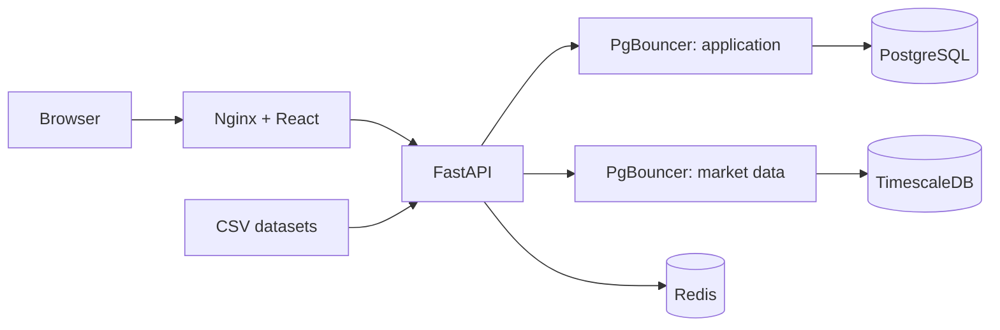

# Performance data stack

EdgeLab is designed to be approachable on a laptop and useful when development
work becomes data- or concurrency-heavy. The default Docker setup intentionally
uses SQLite: it starts quickly, has few moving parts, and is the right place to
begin when you are changing the UI, a strategy, or a small API feature.

The optional performance overlay is for the point where that simplicity becomes
a constraint. It restores the project's PostgreSQL, TimescaleDB, Redis, and
PgBouncer architecture in a form that is safe to run locally and easy for
contributors to understand. It is a development and single-host test stack,
not an HA or public-internet deployment recipe.

## Choosing a stack

| Choose this | When it is a good fit | What it runs |
| --- | --- | --- |
| `docker-compose.local.yml` | UI work, first-time setup, small CSV datasets, or one developer | Frontend, FastAPI, Better Auth, and SQLite volumes |
| Local + performance overlay | Large candle imports, SQL/query work, cache/rate-limit work, concurrent API testing, or realistic integration tests | Everything above plus PostgreSQL, TimescaleDB, Redis, and two PgBouncer services |
| Native development | You need hot reload or want to attach local debuggers | Services you start yourself; you select SQL/Redis with environment variables |

Changing Compose files selects a different local data store. It does not move
existing SQLite records or candle history. Treat the overlay as a fresh
development environment unless you deliberately export, import, verify, and
retain a rollback copy of the original data.

## Start the overlay

From the repository root, copy the example environment file if you do not
already have one, then start both Compose files in this order:

```bash
cp .env.example .env
docker compose -f docker-compose.local.yml -f docker-compose.performance.yml up -d --build
```

Open <http://localhost:8080> after the API becomes healthy. Compose preserves
the SQL volumes across a normal `down`; remove them only when you intentionally
want a clean development database:

```bash
docker compose -f docker-compose.local.yml -f docker-compose.performance.yml down
# Destructive: also removes the SQLite, PostgreSQL, and TimescaleDB volumes.
docker compose -f docker-compose.local.yml -f docker-compose.performance.yml down -v
```

Useful checks while developing:

```bash
docker compose -f docker-compose.local.yml -f docker-compose.performance.yml ps
docker compose -f docker-compose.local.yml -f docker-compose.performance.yml logs -f api
curl http://localhost:8080/api/health
```

All data-service ports bind to `127.0.0.1` by default. They are available to
local database tools but are not exposed on every network interface:

| Service | Host port | Internal endpoint | Persistent state |
| --- | --- | --- | --- |
| PostgreSQL | `5432` | `pgbouncer-postgres:6432` | `postgres-data` volume |
| TimescaleDB | `5433` | `pgbouncer-timescaledb:6432` | `timescaledb-data` volume |
| PostgreSQL PgBouncer | `6432` | `pgbouncer-postgres:6432` | Generated at startup |
| TimescaleDB PgBouncer | `6433` | `pgbouncer-timescaledb:6432` | Generated at startup |
| Redis | `6379` | `redis:6379/0` | Deliberately disposable |

If a port is already in use, change its corresponding `EDGELAB_*_PORT` setting
in `.env`; do not change the internal service address unless you are replacing
the service itself.

## How the services work together



PostgreSQL is the durable source of truth for EdgeLab's transactional
application records. TimescaleDB is a separate PostgreSQL-compatible store for
market candles; the application creates a Timescale hypertable when the
extension is available. Keeping candle traffic separate prevents broad market
imports and historical scans from consuming the same connections and resources
as accounts, journal entries, and application settings.

PgBouncer provides transaction pooling in front of each database. Application
workers can have many client connections without turning each one into a
long-lived server connection. This is useful for bursty web workloads, but it
does not create database capacity: pool limits must still fit within the
available PostgreSQL/TimescaleDB resources.

Redis is intentionally not durable. EdgeLab uses it for versioned read-model
caches and shared admission/rate-limit state. SQL remains authoritative. A
cache failure can be recomputed from SQL, while shared provider-admission
limits fail closed when Redis is configured but unavailable. Redis runs with
`noeviction` so quota keys are not silently discarded under memory pressure;
monitor or increase `EDGELAB_REDIS_MAXMEMORY` when a real workload needs it.

## Configuration and capacity

The overlay uses development defaults from `.env.example`. They are convenient
for a local machine, not public-deployment credentials. Set a unique
`POSTGRES_PASSWORD` before sharing a host or data volume. The API receives
internal service names automatically when the overlay is used:

```text
Application SQL  -> pgbouncer-postgres:6432 -> postgres:5432
Market SQL       -> pgbouncer-timescaledb:6432 -> timescaledb:5432
Shared cache     -> redis://redis:6379/0
```

The most relevant tuning controls are:

| Variable | Default | Purpose |
| --- | ---: | --- |
| `EDGELAB_DB_POOL_SIZE` | `5` | Persistent connections allowed per SQLAlchemy engine/process |
| `EDGELAB_DB_POOL_MAX_OVERFLOW` | `10` | Temporary client-connection overflow per process |
| `EDGELAB_PGBOUNCER_MAX_CLIENT_CONN` | `400` | Client connections admitted by each pooler |
| `EDGELAB_PGBOUNCER_DEFAULT_POOL_SIZE` | `25` | Regular database-server connections per pooler/database |
| `EDGELAB_PGBOUNCER_RESERVE_POOL_SIZE` | `5` | Extra server connections for temporary pressure |
| `EDGELAB_REDIS_MAXMEMORY` | `256mb` | Maximum memory for the disposable Redis service |

Start with the defaults. If you change a pool size, account for every API
process and background worker using that database. Increasing application pool
limits above database capacity usually produces longer queues and timeouts, not
more throughput. Measure the bottleneck first: database CPU/IO, slow queries,
lock waits, cache hit rate, or an external market-data source.

## Data lifecycle and safe reset

The overlay creates named Docker volumes for PostgreSQL and TimescaleDB. A
normal Compose shutdown retains them. Dataset CSV files are still read from the
repository's `datasets/` directory and are not committed to Git.

For a disposable test reset, use `down -v` with the same two Compose files.
This deletes local development data and cannot be undone. For anything worth
keeping, make logical database backups and test restoring them in a separate
environment. Copying a live database data directory is not a supported backup
procedure.

The overlay does not include automatic HA, replication, public TLS, a managed
secret store, or coordinated multi-store backups. Those are deployment design
decisions, not switches to enable casually in a contributor configuration.

## Troubleshooting

| Symptom | Likely cause | What to check |
| --- | --- | --- |
| A service will not start because a port is in use | A local database, Redis, or prior Compose project owns the port | Change the matching host-port variable in `.env`, then recreate the stack |
| API waits for a data service | Database/pooler health check has not passed | `docker compose ... logs postgres timescaledb pgbouncer-postgres pgbouncer-timescaledb` |
| Application data appears empty after switching stacks | SQLite and the overlay use different stores | Switch back to the same Compose selection, or migrate data intentionally |
| Candle import is slow | CSV parsing, disk IO, index work, or an undersized local machine | Check API and TimescaleDB logs; import a smaller dataset before tuning pools |
| Shared quotas return service-unavailable responses | Redis was configured but is unhealthy/full | Check `docker compose ... logs redis` and Redis memory settings |
| A database client cannot connect | The service is intentionally loopback-only or its port was changed | Use `127.0.0.1` and the current `.env` host port, not the Compose service name |

For code-level configuration details, see [Configuration](configuration.md).
For the broader ownership model, see [Architecture](architecture.md). For
contributor expectations and tests, see [Contributing](../CONTRIBUTING.md).
